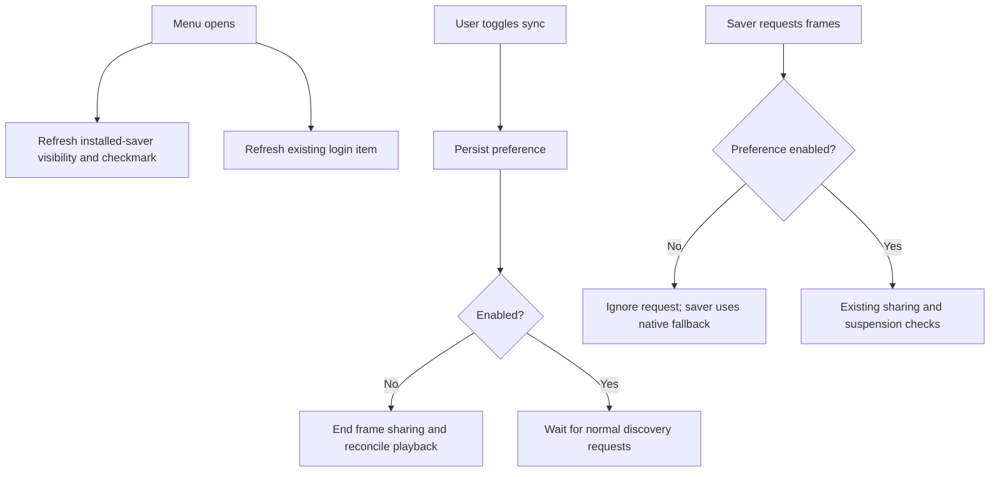

# Screen Saver Sync Toggle - Plan

## Goal Capsule

- **Objective:** Users can choose whether the Matrix screen saver follows their wallpaper animation or plays independently.
- **Means:** A persistent wallpaper menu toggle gates the existing frame producer (KTD1).
- **Authority:** Product requirements govern behavior; technical decisions govern implementation within those requirements.
- **Execution:** Two small, sequential units; implement and verify locally. Branch creation, commits, pushes, and PRs require explicit user instruction.
- **Stop condition:** Ask before changing the confirmed behavior or introducing a new cross-process protocol. The implementer completes local verification; the user decides when to ship.

## Product Contract

### Summary

Add “Sync with Screen Saver” to the wallpaper menu when the Matrix screen saver is installed. Remember the choice and default to enabled.

### Problem Frame

The wallpaper currently serves its animation to the screen saver automatically. Users have no menu control for choosing independent screen-saver playback.

### Requirements

**Menu and preference**

- R1. Show a native checkmarked “Sync with Screen Saver” item only when the Matrix screen saver is installed; refresh availability whenever the menu opens.
- R2. Treat an absent preference as enabled, including first installation and upgrades without this preference; preserve explicit choices across app launches and saver removal/reinstallation.

**Playback**

- R3. Checked permits the existing wallpaper-to-screen-saver frame sharing; unchecked makes the saver use its own renderer.
- R4. Disabling ends active sharing and blocks subsequent requests; enabling allows subsequent requests to reconnect without restarting wallpaper animation.
- R5. The toggle preserves wallpaper Start/Stop, sleep/session suspension, Launch at Login, rendering options, and existing within-host multi-monitor coordination.

### Acceptance Examples

- AE1. Covers R1, R2: With no saved choice and an installed saver, opening the menu shows the item checked. Without an installed saver, the item is hidden.
- AE2. Covers R2, R3: Uncheck the item and relaunch the app; it remains unchecked and a newly started saver renders independently.
- AE3. Covers R4, R5: Disable during frame sharing; the consumer falls back, hidden wallpaper work stops when suspension requires it, and re-enabling permits discovery to resume without overriding Stop or sleep.
- AE4. Covers R1, R2: Remove and reinstall the saver between menu openings; visibility changes and the previous preference survives.

### Scope Boundaries

This controls wallpaper-to-saver sharing, not synchronization between monitors or shared visual options. No new preference in the saver Options sheet, installer changes, dependencies, or background service. Menu-open detection is sufficient; continuous filesystem watching adds no required behavior.

## Planning Contract

### Key Technical Decisions

- KTD1. **Gate the producer in `WallpaperApp`.** Persist a wallpaper-owned Boolean in its `UserDefaults` domain with a registered true default. Check it before `shareFrames(for:)` performs any work. On disable, reuse `endFrameSharing()` followed by `reconcilePlayback()`. The consumer already falls back when the producer disappears and retries discovery, so no shared preference reads or notification-format changes are needed (R2–R5).
- KTD2. **Detect installed bundles without loading their executable.** Inspect direct `.saver` children of the user and local Library `Screen Savers` directories, matching `CFBundleIdentifier` against `dev.patsch.MatrixScreenSaver`. Resolve standard Library locations through Foundation; renamed bundles and symlinked installations should work. Missing, unreadable, malformed, or unrelated bundles count as absent. Build output and Trash are not installed locations. This check controls menu visibility, not whether an already running consumer may request frames (R1).
- KTD3. **Let the app coordinate menu refresh.** Make `WallpaperApp` the menu delegate and forward menu opening to the existing `LoginItemController.menuWillOpen`. Refresh the sync item's visibility and checkmark in that same callback. Keep the small availability helper in the existing app file; inject defaults and search locations for isolated tests, following the constructor-injection pattern already used for login controls (R1, R2, R5).

### High-Level Technical Design

### Evidence and Constraints

- `Sources/MatrixWallpaper/WallpaperApp.swift`: menu delegate currently belongs to `loginItems`; `shareFrames(for:)`, `endFrameSharing()`, and `reconcilePlayback()` own producer lifecycle.
- `Sources/MatrixScreenSaver/WallpaperFrameReader.swift`: consumers retry discovery every 0.5 seconds.
- `Sources/MatrixScreenSaver/SharedWallpaperFrame.swift`: producer teardown unlinks its offer; snapshots reject unavailable/stale output.
- `Sources/MatrixScreenSaver/MatrixScreenSaverView.swift`: lost frames switch to native playback; later shared frames stop that native simulation.
- `Tests/MatrixWallpaperTests/ConsumerHost.swift`: already covers actual consumer fallback and reconnection. Keep this regression coverage rather than duplicating its implementation.
- `Resources/Info.plist`: authoritative saver bundle identifier.
- AppKit interaction requires a logged-in graphical macOS session. Actual System Settings hosting remains a manual verification item; planning has not run it.

## Implementation Units

### U1. Add the persistent conditional menu control

**Goal:** Expose the confirmed preference without disrupting existing menu controls.

**Requirements:** R1, R2, R5. **Dependencies:** None.

**Files:** `Sources/MatrixWallpaper/WallpaperApp.swift`; `Tests/MatrixWallpaperTests/WallpaperAppTests.swift`; `Tests/MatrixWallpaperTests/LoginItemTests.swift` if shared test support needs adjustment.

**Approach:**
1. Add the preference, menu item, and bounded installed-bundle detection per KTD2–KTD3.
2. Persist toggle actions and refresh native menu state. Keep preference storage separate from `MatrixScreenSaverOptions`.
3. Use temporary bundle fixtures and an isolated defaults suite in tests; do not alter the user's installed saver or login registration.

**Patterns:** Existing `LoginItemController` dependency injection and native menu-action tests.

**Test scenarios:**
1. Covers AE1: No stored value produces a checked item; an explicit false value survives constructing another host with the same test store.
2. Covers AE4: User/local installation fixtures show the item; removing both hides it; reinstalling retains the saved false value.
3. Renamed and symlinked matching bundles are found; wrong identifiers, malformed metadata, and missing directories are ignored.
4. Opening the real app menu refreshes both sync availability and changed login-item status.

**Verification:** Menu actions persist the choice, menu-open callbacks refresh both controls, and tests use no real preference or installation changes.

### U2. Apply the preference to frame sharing and verify the lifecycle

**Goal:** Make the choice govern real animation sharing.

**Requirements:** R3–R5. **Dependencies:** U1.

**Files:** `Sources/MatrixWallpaper/WallpaperApp.swift`; `Tests/MatrixWallpaperTests/WallpaperAppTests.swift`; existing regression coverage in `Tests/MatrixWallpaperTests/ConsumerHost.swift`; `README.md`.

**Approach:**
1. Apply KTD1 at the shared request entry point and toggle action, retaining existing display validation and suspension checks.
2. Extend host tests through real menu actions and frame discovery, using the existing bounded run-loop helpers.
3. Document the default, persistence, conditional visibility, and independent-playback behavior in the README.

**Test scenarios:**
1. Covers AE2: With sync off, repeated requests produce no frames and do not wake hidden wallpaper rendering.
2. Covers AE3: Disable an active producer, confirm its offer disappears and no subsequent request recreates it; the existing consumer-host regression proves native fallback.
3. Re-enable and request again; fresh frames return from the same wallpaper views without an animation restart.
4. Toggle while stopped or sleeping; wallpaper remains stopped or suspended. Wake respects the saved preference.
5. Default-enabled behavior still passes existing multi-display sharing, lease expiry, and saver-exit tests.

**Verification:** Producer tests and consumer-host regressions pass together; the real screen saver visibly switches between shared and independent playback.

## Verification Contract

- `./wallpaper-tests.sh`: native menu, preference, producer lifecycle, and consumer-host regressions.
- `./tests.sh`: renderer, shared-frame, and coordination regression suite.
- `./build-wallpaper.sh` and `./build.sh`: both native bundles compile successfully.
- Manual macOS check: menu presence with user/local installation; remembered toggle after relaunch; real saver with sync on and off; normal wallpaper resume after saver exit. Use existing installations where possible and obtain permission before changing the user's installed bundles.
- No CI/release workflow changes or triggers are required. New source files are not planned; if implementation needs one, add it to the applicable explicit compiler source lists.

## Definition of Done

- U1 proves R1–R2 through isolated menu/persistence tests; U2 proves R3–R5 through sharing tests and existing consumer regressions.
- Verification gates pass; any unavailable graphical or real-host check is explicitly reported.
- README explains the user-facing option, and new internal declarations follow Swift documentation conventions.
- Abandoned experiments and unused test hooks are removed; no unrelated renderer or installer refactoring remains.
